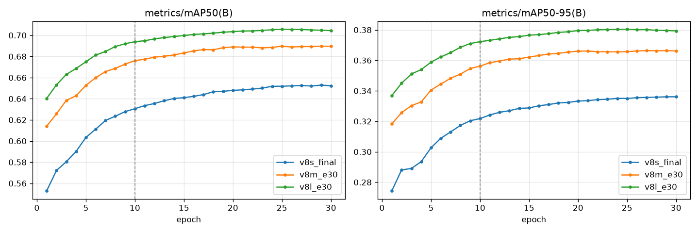

# BDD100K 行人检测：YOLOv8 s / m / l 对比

[English](README.md)

2025 年我发表了一篇会议论文，在 BDD100K 自动驾驶数据集上比较 YOLOv8s / m / l 三个规模的模型做行人检测。当时时间紧，再加上还要准备毕业论文答辩，还有一些学校的实验，只训练了 10 轮。这个仓库把那项研究从头复现了一遍，把训练轮次加到 30 轮，把每个模型训练充分，并按光照、天气、拥挤程度和目标大小拆开分析结果。

结果比我预想的好：三个模型都明显超过了论文里的成绩，论文里 v8m 那个奇怪的数字也没有再出现。拆开分析之后还发现，模型最大的问题是远处的小行人，夜间的影响没有我原来以为的那么大。

## 主要发现

1. 论文低估了这三个模型，mAP50 分别提高了 0.12、0.07、0.02（s、m、l）。第一次在自己电脑上做冒烟测试时，只用 10% 的数据训练 1 轮，mAP50 就有 0.487，和论文 10 轮的 0.534 差不多，我还以为是代码哪里出了问题。后来对比发现，新实验训练到第 10 轮时就已经比论文高很多，所以差距不完全是训练轮数造成的，具体见[和论文相比改了什么](#和论文相比改了什么)。
2. 论文里 v8m 的 mAP50-95 比 v8s 还低（0.249 对 0.263），这次没有出现，三个模型的顺序是正常的。
3. 如果要选一个部署到车上，我会选 v8m。s 换 m，速度慢 16%，mAP50 高 0.037；m 换 l，速度再慢 9%，参数多 70%，mAP50 只高 0.015。
4. 小行人（小于 32×32 像素）检测得很差，AP50 只有 0.41 到 0.48，大的能到 0.93 以上。白天和夜间只差 0.06 左右。
5. 按天气分组时，晴天的分数居然比阴天低，一开始我没看懂。后来把天气和时段交叉统计了一下，发现标成晴天的图里 61% 是夜间拍的（晚上看不出有没有云），阴天里夜间图只有 1.5%。所以晴天分数低主要是因为夜间图多，跟天气本身关系不大。

## 结果

所有数字都在 BDD100K 完整验证集上测得（1 万张图，13262 个行人），单一类别，输入尺寸 640。

### 论文 vs 本仓库

| 模型    | 参数量  | 论文 mAP50 | 论文 mAP50-95 | **本仓库 mAP50** | **本仓库 mAP50-95** | 召回率 |
| ------- | -------:| ----------:| -------------:| ----------------:| -------------------:| ------:|
| YOLOv8s | 1110 万 | 0.534      | 0.263         | **0.654**        | **0.337**           | 0.570  |
| YOLOv8m | 2590 万 | 0.618      | 0.249         | **0.691**        | **0.368**           | 0.613  |
| YOLOv8l | 4360 万 | 0.683      | 0.365         | **0.706**        | **0.382**           | 0.615  |

### 精度与速度

| 模型    | mAP50     | 小目标 AP50 | 夜间 mAP50 | FPS（RTX 4090，batch 1，端到端） |
| ------- | ---------:| -----------:| ----------:| --------------------------------:|
| YOLOv8s | 0.654     | 0.410       | 0.603      | **101.6**                        |
| YOLOv8m | 0.691     | 0.456       | 0.644      | 85.1                             |
| YOLOv8l | **0.706** | **0.476**   | **0.664**  | 77.5                             |

FPS 包含读图、预处理、推理和 NMS。论文里的 FPS（66 / 40 / 26）是在 Apple M3 Max 上测的，硬件不同，绝对数值不能比较，只能比较三个模型之间的相对快慢。

### 训练曲线



三个模型都在第 30 轮之前趋于平稳（v8m 和 v8l 大约在第 20 轮），说明在这套设置下 30 轮基本已经收敛。

### 按条件拆分

下表是各组的 mAP50。完整表格（含 mAP50-95 和召回率）见 [`reports/eval_*/group_metrics.md`](reports)。

| 分组           | 取值      | 图片数 | 行人数 | v8s   | v8m   | v8l   |
| -------------- | --------- | ------:| ------:| -----:| -----:| -----:|
| 时段           | 白天      | 5,258  | 9,366  | 0.669 | 0.707 | 0.720 |
|                | 夜间      | 3,929  | 2,843  | 0.603 | 0.644 | 0.664 |
|                | 黎明/黄昏 | 778    | 1,046  | 0.655 | 0.676 | 0.693 |
| 天气           | 晴        | 5,346  | 4,935  | 0.634 | 0.676 | 0.695 |
|                | 阴        | 1,239  | 1,916  | 0.671 | 0.706 | 0.723 |
|                | 雨        | 738    | 822    | 0.616 | 0.647 | 0.661 |
|                | 雪        | 769    | 1,137  | 0.702 | 0.733 | 0.753 |
| 拥挤（≥10 人） | 拥挤      | 351    | 5,255  | 0.666 | 0.704 | 0.714 |
|                | 不拥挤    | 9,649  | 8,007  | 0.650 | 0.687 | 0.705 |
| 目标大小*      | 小        |        | 6,399  | 0.410 | 0.456 | 0.476 |
|                | 中        |        | 6,108  | 0.828 | 0.854 | 0.864 |
|                | 大        |        | 755    | 0.932 | 0.946 | 0.952 |

\* 大小分组的 AP50 由 [`scripts/size_ap.py`](scripts/size_ap.py) 自行计算（IoU 0.5 贪心匹配、全点插值、COCO 面积阈值 32² / 96²），适合在本仓库内比较不同模型，不适合和其他论文的数字直接比较。

少于 20 张图的分组会被跳过（例如雾天只有 13 张）；时段为 undefined 的分组只有 7 个行人，没有分析价值。

**几点观察**

- 三个模型在夜间都比白天低 0.06 左右。换大模型之后白天和夜间涨得差不多，差距没有缩小。另外训练集本身就不平衡：夜间图片占 40%，行人框只占 21%。
- 天气和时段是混在一起的（见上面第 5 条）。雨天比较特别：它的小目标比例低于平均，分数却是所有天气里最低的，可能是反光、模糊这些因素真的有影响。
- 拥挤场景的 mAP50 稍高，但 mAP50-95 更低（v8l：0.368 对 0.394）。我的理解是人挤在一起时能找到，但互相遮挡，框的边界不好画准。
- 小目标占全部行人的 48%。输入从 1280×720 缩到 640，一个 30 像素高的行人只剩 15 像素左右。从 s 换到 l，小目标提升了 16%，但离大目标还差得很远。

## 和论文相比改了什么

|                                 | 论文                                                                                     | 本仓库                                                             |
| ------------------------------- | ---------------------------------------------------------------------------------------- | ------------------------------------------------------------------ |
| 训练轮数                        | 10                                                                                       | 30                                                                 |
| Mosaic 数据增强                 | 如果用的是 Ultralytics 默认设置，`close_mosaic=10` 加上总共 10 轮，mosaic 全程都是关闭的 | 第 1–20 轮开启，第 21–30 轮关闭                                    |
| 标注转换                        | 原始代码已丢失                                                                           | 重写，并有单元测试（[`scripts/bdd_core.py`](scripts/bdd_core.py)） |
| 硬件                            | Apple M3 Max（MPS）                                                                      | RTX 4090（CUDA）                                                   |
| 优化器、学习率、batch、输入尺寸 | SGD，640；v8s 学习率 0.001、batch 8，v8l 学习率 0.0005、batch 4                          | 相同（论文未写明 v8m 的设置，本仓库用学习率 0.0007、batch 6）      |

同一训练阶段的验证集 mAP50：

| 模型 | 论文（10 轮结束） | 本仓库第 10 轮（共 30 轮） | 本仓库第 30 轮 |
| ---- | -----------------:| --------------------------:| --------------:|
| v8s  | 0.534             | 0.631                      | 0.652          |
| v8m  | 0.618             | 0.676                      | 0.690          |
| v8l  | 0.683             | 0.694                      | 0.704          |

新实验在第 10 轮时就已经领先，所以提升不只是因为训练更久。可能的原因包括 mosaic 处于开启状态，以及学习率安排不同（按 30 轮线性下降，第 10 轮时学习率仍然较高）。我没有做消融实验把这几个因素分开，所以这仍然是推测。

关闭 mosaic 的效果在日志里能直接看到：第 20 到 21 轮之间，训练集的 box loss 突然下降（v8l：1.487 → 1.239），验证集的 mAP 却几乎不变。原因是训练图片突然变简单了，而考试题没有变。

## 复现

训练在租用的 RTX 4090 上完成。整个准备流程（依赖、下载数据、转换标注、跑测试）只需要一个脚本：

```bash
git clone https://github.com/asiansumer/yolov8-bdd100k-pedestrian.git
cd yolov8-bdd100k-pedestrian
export KAGGLE_API_TOKEN=...          # BDD100K 的 Kaggle 镜像，见下方说明
bash scripts/setup_cloud.sh

python scripts/train.py --config yolov8s --device 0 --name v8s_final   # 4090 上约 7 小时
python scripts/evaluate_by_group.py --weights runs/v8s_final/weights/best.pt --device 0
python scripts/benchmark_fps.py --weights runs/v8s_final/weights/best.pt --device 0 --n 500
```

把 `yolov8s` 换成 `yolov8m` / `yolov8l` 即可训练其他模型。在 macOS 本地配置环境的步骤见 [SETUP.md](SETUP.md)。

**数据来源：** 做这个项目时，官方下载站（bdd-data.berkeley.edu）无法访问，所以数据来自 Kaggle 上的镜像（`solesensei/solesensei_bdd100k`，2018 版标注）。这份镜像把训练图片分到了几个子文件夹里，`setup_cloud.sh` 会自动把它们整理好。BDD100K 的许可证不允许再分发，所以本仓库不包含任何图片。

**训练好的模型**放在 [GitHub Releases](https://github.com/asiansumer/yolov8-bdd100k-pedestrian/releases)。

## 仓库结构

```
scripts/
  bdd_core.py            BDD 标注框 -> YOLO 格式、目标大小分组（核心逻辑，有单元测试）
  convert_bdd_to_yolo.py 转换一个数据划分，并记录每张图的天气、时段、行人数
  setup_cloud.sh         一键准备环境和数据
  train.py               按 configs/<名字>.yaml 训练
  evaluate_by_group.py   按场景和目标大小分组评估
  size_ap.py             按目标大小计算 AP50
  benchmark_fps.py       端到端推理速度
  plot_curves.py         每轮 mAP 的对比曲线
  dataset_stats.py, visualize_samples.py   数据检查
configs/                 每个模型的超参数（与论文一致）
tests/                   标注转换和 AP 计算的单元测试
reports/                 本文所有的结果表格和图
```

## 局限性

- 每个模型只训练了一次，没有换随机种子重复，0.01 左右的差别不能说明太多。
- 没有做消融实验，mosaic、学习率安排、训练轮数各自起了多大作用还不清楚。
- 有些分组样本太少：雨天 822 个行人，黎明/黄昏 1046 个，白天有 9366 个。雾天的图太少，没法评估。
- 硬件和论文不同，FPS 只能在这个仓库里互相比较。
- 数据副本和转换代码也和论文时不一样，这也可能影响结果。

## 下一步

- 用更大的输入尺寸（例如 1280）专门改善小目标
- 基于这里的检测模型，在 BDD100K 视频上做多目标跟踪（下一个项目）

## 参考文献

- Yaxiaer Yashengjiang. *A Comparative Analysis of Pedestrian Detection Performance for YOLOv8 Models on the BDD100K Dataset.* Conference paper, 2025.
- F. Yu et al. *BDD100K: A Diverse Driving Dataset for Heterogeneous Multitask Learning.* CVPR 2020.
- G. Jocher et al. *Ultralytics YOLOv8.* https://github.com/ultralytics/ultralytics
